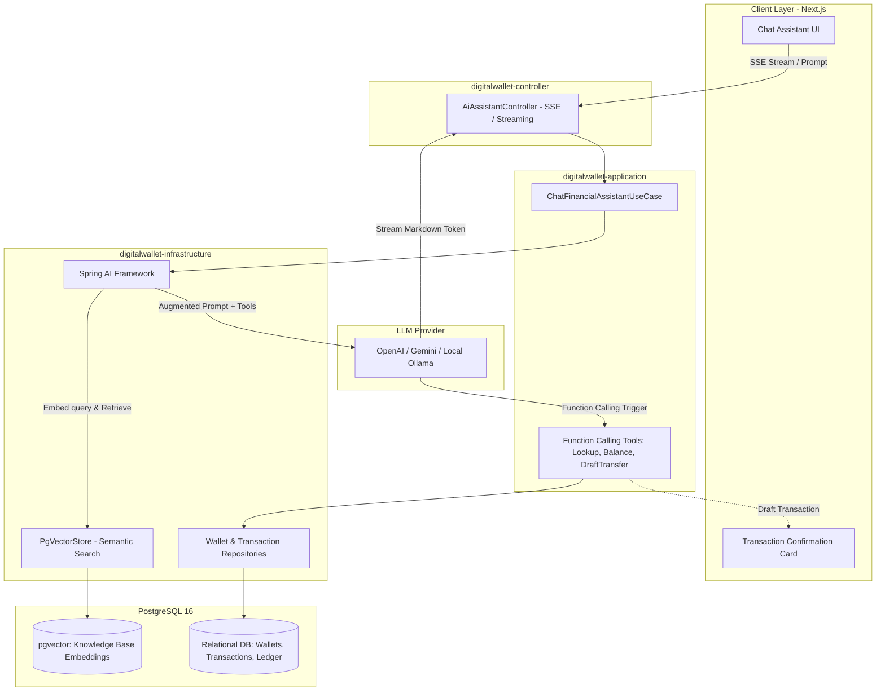
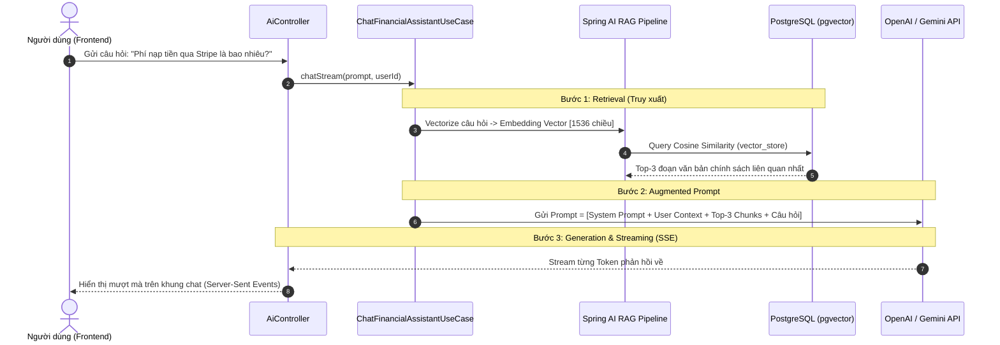

# 🤖 AI & RAG Architecture for Digital Wallet

> Học theo mã hiện tại, cách chạy và bài tập: [Hướng dẫn học AI/RAG](ai-rag-learning-guide.md). Tài liệu bên dưới giữ nguyên phần thiết kế và lộ trình ban đầu.

Tài liệu này mô tả chi tiết thiết kế kiến trúc, nguyên lý hoạt động và lộ trình triển khai hệ thống **AI & RAG (Retrieval-Augmented Generation)** tích hợp trực tiếp vào **Digital Wallet** sử dụng **Spring AI** và **PostgreSQL (pgvector)**.

---

## 1. Mục tiêu & Định hướng Kỹ thuật

### Tại sao không dùng microservice Python riêng?
- **Tối ưu hạ tầng:** Tận dụng trực tiếp **Spring AI** (hệ sinh thái chính chủ của Spring Boot 3) và **PostgreSQL `pgvector`** (đã có sẵn container PostgreSQL trong `docker-compose.yml`).
- **Đồng bộ Domain & Transaction:** AI Use Case nằm trong kiến trúc DDD sẵn có, có thể trực tiếp gọi các Domain Service, Repositories, và kiểm soát bảo mật Spring Security/JWT mà không cần thêm API Gateway trung gian.
- **Tạo ấn tượng trên CV:** Thể hiện năng lực **Modern Java Engineer** làm chủ **Spring AI + Enterprise RAG**, bắt kịp xu hướng thị trường tuyển dụng hiện đại.

---

## 2. Sơ đồ Kiến trúc Tổng thể



---

## 3. Các Use Case AI cốt lõi trong Hệ thống Ví

### Use Case 1: RAG Financial Assistant (Tra cứu chính sách & hỏi đáp thông minh)
- **Nguồn tri thức tĩnh (Static Knowledge Base):**
  - Chính sách hoàn tiền, điều khoản giao dịch.
  - Biểu phí nạp / rút / chuyển tiền qua các cổng PayOS, Stripe, Ngân hàng.
  - Hạn mức giao dịch ngày, quy trình khiếu nại, hướng dẫn bảo mật mã PIN/OTP.
- **Ngữ cảnh động (Dynamic User Context):**
  - Tự động nạp thông tin User hiện tại (Số dư ví, trạng thái ví, 5 giao dịch gần nhất) vào System Prompt để AI trả lời cá nhân hóa:
    - *"Hạn mức còn lại trong ngày của tôi là bao nhiêu?"*
    - *"Tại sao giao dịch #TX-1234 của tôi bị tạm khóa?"*

### Use Case 2: AI Agent with Function Calling (Trợ lý điều phối giao dịch - Human-in-the-loop)
- **Bài toán:** Người dùng gõ: *"Chuyển 50.000đ cho bạn Nam kèm lời nhắn tiền ăn trưa"*.
- **Nguyên tắc an toàn Fintech (BẮT BUỘC):** **AI KHÔNG ĐƯỢC TỰ ĐỘNG CHUYỂN TIỀN!**
- **Luồng xử lý:**
  1. LLM nhận diện Intent $\rightarrow$ gọi tool `searchBeneficiary(query="Nam")`.
  2. Backend trả về ví người nhận.
  3. LLM gọi tool `checkBalance()` $\rightarrow$ Backend kiểm tra đủ số dư.
  4. LLM trả về lệnh `draftTransfer` $\rightarrow$ Frontend render **Phiếu xác nhận giao dịch (Confirmation Card)**.
  5. Người dùng kiểm tra thông tin và nhập **Mã PIN / OTP** $\rightarrow$ Hệ thống Backend mới thực thi trừ tiền thật.

### Use Case 3: Smart Expense Insights (Phân loại & Báo cáo chi tiêu cá nhân)
- AI tự động gắn nhãn (Tags: `Ăn uống`, `Mua sắm`, `Hóa đơn`, `Giải trí`) dựa vào nội dung chuyển tiền (e.g. *"bún bò"*, *"tiền phòng trọ"*, *"vé xem phim"*).
- Định kỳ tạo tóm tắt tài chính: *"Tháng này bạn đã chi 4.500.000đ, trong đó chi phí Ăn uống tăng 18% so với tháng trước..."*.

---

## 4. Chi tiết Cơ chế RAG Pipeline (Spring AI + pgvector)



---

## 5. Cấu trúc Dữ liệu Vector trong PostgreSQL (`pgvector`)

Bảng `vector_store` do Spring AI tự động quản lý hoặc tạo qua migration:

```sql
-- Cần kích hoạt extension vector trong PostgreSQL
CREATE EXTENSION IF NOT EXISTS vector;

CREATE TABLE IF NOT EXISTS vector_store (
    id         UUID PRIMARY KEY DEFAULT gen_random_uuid(),
    content    TEXT NOT NULL,               -- Nội dung đoạn văn bản (chunk)
    metadata   JSONB,                       -- Nguồn tài liệu, danh mục (doc_type, title, page)
    embedding  vector(1536)                 -- Vector nhúng (1536 chiều cho OpenAI text-embedding-3-small)
);

-- Index tìm kiếm vector tốc độ cao (HNSW Index)
CREATE INDEX IF NOT EXISTS idx_vector_store_hnsw 
ON vector_store USING hnsw (embedding vector_cosine_ops);
```

---

## 6. Lộ trình triển khai (Implementation Plan)

### Giai đoạn 1: Chuẩn bị Hạ tầng & Dữ liệu
1. **Nâng cấp `docker-compose.yml`:** Đổi image PostgreSQL sang `pgvector/pgvector:pg16`.
2. **Kích hoạt Extension:** Viết file migration `V13__setup_pgvector.sql`.
3. **Thêm Dependency:** Khai báo Spring AI BOM và `spring-ai-starter-model-openai` (hoặc `ollama`/`gemini`) trong Maven.
4. **Knowledge Base:** Tạo thư mục tài liệu `docs/knowledge-base/` chứa các file markdown:
   - `fee-policy.md` (Chính sách phí giao dịch)
   - `security-guide.md` (Hướng dẫn an toàn mã PIN & OTP)
   - `transaction-limits.md` (Hạn mức giao dịch theo cấp độ tài khoản)

### Giai đoạn 2: Xây dựng Ingestion & RAG Service (Backend)
1. **`DocumentIngestionService`:** Tự động đọc các file Markdown, chunk nhỏ (500 tokens), gọi Embedding API và lưu vào `vector_store`.
2. **`FinancialAdvisorService`:** Tích hợp `VectorStore` + `ChatClient` của Spring AI.
3. **`FinancialTools`:** Khai báo Spring AI `@Tool` / Function Calling:
   - `lookupRecipient(nameOrPhone)`
   - `checkWalletBalance()`
   - `createDraftTransfer(recipientId, amount, note)`

### Giai đoạn 3: Controller & Streaming SSE
1. Viết `AiAssistantController` hỗ trợ **Server-Sent Events (`MediaType.TEXT_EVENT_STREAM_VALUE`)** để stream câu trả lời từng từ về frontend.
2. Endpoint: `POST /api/v1/ai/chat/stream`.

### Giai đoạn 4: Giao diện Chat Frontend (Next.js)
1. Xây dựng Chat Drawer / Floating Widget góc phải màn hình hoặc trang riêng `/dashboard/ai-assistant`.
2. Hỗ trợ hiển thị Markdown: Bảng biểu, code block, in đậm.
3. Hỗ trợ **Interactive Confirmation Card** khi AI trả về Function Calling chuyển tiền.
