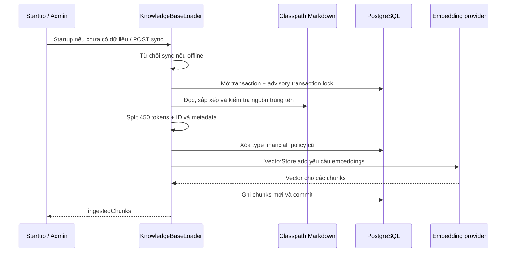
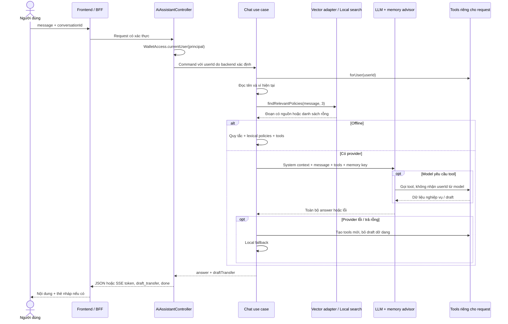
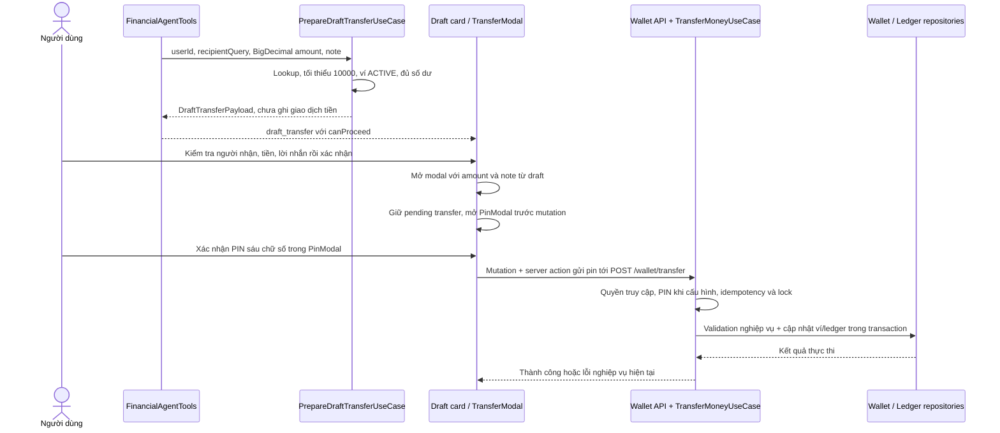

# Học AI và RAG qua Digital Wallet

Hướng dẫn này dành cho người muốn lần theo mã, chạy thử và tự giải thích được tính năng AI của dự án.
Đọc cùng [tài liệu kiến trúc](ai-rag-architecture.md) và [hướng dẫn môi trường](../environment/README.md).
Tài liệu kiến trúc có cả định hướng; các hành vi dưới đây mô tả implementation trong workspace đang phát triển.
Các lệnh là hướng dẫn tự kiểm tra, không phải bằng chứng đã triển khai hay đã gọi thành công provider thật.

## 1. Hiểu bốn cơ chế trước khi đọc mã

| Cơ chế | Dữ liệu đầu vào | Vai trò trong dự án |
| --- | --- | --- |
| RAG | Markdown chính sách được truy xuất | Bổ sung bằng chứng trước khi LLM trả lời |
| Tool calling | Tham số do model đề xuất, danh tính do backend gắn | Đọc số dư, tìm người nhận, xem giao dịch, tạo nháp |
| Memory | Tin nhắn của một cuộc hội thoại | Giữ ngữ cảnh cho lần gọi model tiếp theo |
| Offline | Từ khóa, regex, dữ liệu ví và đoạn chính sách | Phản hồi có quy tắc khi không dùng được provider |

RAG không huấn luyện lại model: tài liệu được đưa vào ngữ cảnh tại thời điểm hỏi.
Tool trả dữ liệu nghiệp vụ hiện tại, trong khi tài liệu chính sách là tri thức tĩnh.
Offline không phải một LLM chạy local: đây là nhánh Java dùng tìm kiếm từ vựng và quy tắc.

## 2. Bản đồ file và thứ tự đọc

Các tên Java bên dưới nằm dưới `src/main/java/com/tyson/digitalwallet/ddd/` của module tương ứng.

| Thứ tự | File / vị trí | Câu hỏi cần trả lời khi đọc |
| --- | --- | --- |
| 1 | `backend/digitalwallet-controller/.../controller/resource/AiAssistantController.java` | Ai xác định user, endpoint nào trả SSE? |
| 2 | `backend/digitalwallet-controller/.../controller/dto/request/ai/ChatAssistantRequestDto.java` | Request chấp nhận những trường và giới hạn nào? |
| 3 | `backend/digitalwallet-application/.../application/usecase/ai/` | Command, response và hợp đồng use case là gì? |
| 4 | `backend/digitalwallet-infrastructure/.../infrastructure/ai/service/ChatFinancialAssistantUseCaseImpl.java` | Context, retrieval, model và fallback nối nhau thế nào? |
| 5 | `backend/digitalwallet-infrastructure/.../infrastructure/ai/adapter/PgVectorKnowledgeAdapter.java` | topK, threshold, filter và citation được gắn ở đâu? |
| 6 | `backend/digitalwallet-infrastructure/.../infrastructure/ai/loader/KnowledgeBaseLoader.java` | Markdown thành vector bằng cách nào? |
| 7 | `backend/digitalwallet-infrastructure/.../infrastructure/ai/service/LocalKnowledgeBaseService.java` | Offline tìm nguồn và trả lời thế nào? |
| 8 | `backend/digitalwallet-infrastructure/.../infrastructure/ai/service/TransferIntentParser.java` | Chuỗi tiền và người nhận được phân tích ra sao? |
| 9 | `backend/digitalwallet-infrastructure/.../infrastructure/ai/tools/FinancialAgentTools.java` | Danh tính và draft có bị dùng chung giữa request không? |
| 10 | `backend/digitalwallet-application/.../application/usecase/ai/impl/PrepareDraftTransferUseCaseImpl.java` | Nháp kiểm tra gì, vì sao chưa trừ tiền? |
| 11 | `backend/digitalwallet-infrastructure/.../infrastructure/config/AiConfig.java` | System prompt mặc định và memory được cấu hình thế nào? |
| 12 | `frontend/src/features/ai-assistant/` | SSE được parse và draft được đưa ra UI ra sao? |
| 13 | `frontend/src/features/wallet/` | Modal và server action gửi giao dịch thật thế nào? |
| 14 | `backend/digitalwallet-start/src/main/resources/application.yaml` | Model, timeout và vector dimensions nằm ở đâu? |

Thay `...` bằng tiền tố package ở trên khi mở file; đây là cách rút ngắn bảng, không phải đường dẫn shell.
Nguồn tri thức thực tế ở `backend/digitalwallet-infrastructure/src/main/resources/knowledge-base/`.
Ba file nguồn là `fee-policy.md`, `transaction-limits.md`, `security-guide.md`.

## 3. Ingestion: từ Markdown tới pgvector

`KnowledgeBaseLoader` vừa là `ApplicationRunner`, vừa triển khai `SyncKnowledgeUseCase`.
Nó đọc `classpath*:knowledge-base/*.md`; file phải có mặt trong classpath của backend đang chạy.
`TokenTextSplitter` đặt chunk size 450 token, min chunk size 100 ký tự và giữ separator.
Chunk nhỏ giúp truy xuất tập trung nhưng dễ mất ngữ cảnh; chunk lớn tăng chi phí prompt và nhiễu.
Mỗi chunk có metadata `source`, `type=financial_policy`, `chunk` là chỉ số đoạn.
ID được tính bằng `UUID.nameUUIDFromBytes` từ `financial_policy:<filename>:<index>`.
ID ổn định theo vị trí, không phải content hash: sửa nội dung ở cùng vị trí vẫn dùng cùng ID; 450 token không phải 450 từ hay ký tự.



Startup có khóa thật chỉ tự ingest khi chưa có chunk `financial_policy`; không tự phát hiện mọi lần sửa tài liệu.
Startup offline bỏ qua remote ingestion; lỗi khởi tạo được log để hệ thống còn có thể dùng local fallback.
Sync thủ công là thay thế toàn bộ tập chính sách trong transaction dùng cùng DataSource với pgvector.
`synchronized` tuần tự hóa trong instance; PostgreSQL advisory transaction lock bảo vệ giữa các instance.
Đọc nguồn sau khi lấy lock tránh snapshot cũ ghi đè lần sync mới đang chạy trước đó.
Xóa trước rồi thêm trong cùng transaction giúp loại bỏ chunk dư khi rút ngắn hoặc xóa file.
Nếu thêm vector lỗi, transaction rollback giúp giữ tập dữ liệu cũ; xem test ingestion để hiểu giả định này.
Nguồn trùng filename nhưng khác nội dung bị từ chối; nội dung trùng nhau được gộp.
Tập nguồn rỗng có thể xóa hết policy vectors: cần kiểm tra đóng gói tài nguyên trước khi sync.

## 4. Embedding, cosine, HNSW, topK và threshold

Migration `backend/digitalwallet-infrastructure/src/main/resources/db/migration/V13__setup_pgvector.sql` tạo cấu trúc vector.
Compose dùng PostgreSQL image `pgvector/pgvector:pg16`; pgvector là extension trong PostgreSQL.
YAML đặt `initialize-schema: false`: cần migration, không dựa vào tự tạo schema của Spring AI.
Embedding mặc định là `text-embedding-3-small`, schema cấu hình 1536 chiều.
Vector câu hỏi và vector tài liệu phải dùng cùng không gian embedding, kích thước và cách tạo tương thích.
Đổi model có thể cần migration dimensions và re-embed toàn bộ dù model mới vẫn có cùng số chiều.
Cosine similarity là `dot(a,b) / (norm(a) * norm(b))`; cosine distance thường biểu diễn `1 - similarity`.
HNSW là index tìm lân cận gần đúng giúp tăng tốc; không phải model, không sinh embedding hay câu trả lời.
Index đánh đổi tài nguyên xây dựng/lưu trữ và độ đầy đủ của truy xuất; không nên coi kết quả luôn là exact search.

`PgVectorKnowledgeAdapter` gọi `similaritySearch` với các điều kiện sau:

- `topK=3` từ chat use case: lấy tối đa ba đoạn, không bắt buộc phải đủ ba.
- `wallet.ai.retrieval-threshold`, mặc định `0.65`: loại đoạn có similarity quá thấp.
- Filter metadata `type == 'financial_policy'`: giới hạn tập dữ liệu dùng cho policy retrieval.
- Kết quả được gắn `[Nguồn: <filename>, chunk: <index>]` trước khi đưa vào prompt.

Threshold không phải xác suất câu trả lời đúng 65%; topK cũng không phải độ tin cậy.
Truy xuất rỗng hoặc lỗi sẽ chuyển sang lexical search; không ép đủ topK bằng dữ liệu không liên quan.
Citation trong context giúp kiểm tra nguồn nhưng không bảo đảm LLM sẽ trích dẫn đầy đủ, chính xác trong câu trả lời.

## 5. Chat: danh tính, context, model và memory



DTO giới hạn message 4000 ký tự, conversationId 128 ký tự; message phải không rỗng.
Client không được chọn danh tính người gửi trong body: controller lấy UUID từ principal đã xác thực.
`FinancialAgentTools.forUser(userId)` tạo đối tượng riêng cho mỗi request với identity backend gắn vào.
`AiContextHolder` được loại bỏ; không dựa vào `ThreadLocal` truyền identity qua executor hoặc tool callbacks.
Draft nằm trên đối tượng tools của request, tránh response của người này lấy nháp người khác.

Memory key là `userId:conversationId`, dùng `default` khi conversationId null hoặc blank.
Hai người dùng gửi cùng conversationId vẫn có key khác nhau nhờ prefix userId.
`MessageWindowChatMemory` giữ tối đa 20 messages, không phải 20 lượt hỏi đáp.
Repository là `InMemoryChatMemoryRepository`: restart mất lịch sử, nhiều replica không tự chia sẻ lịch sử.
Memory advisor tham gia nhánh LLM; offline không tự có hội thoại thông minh nhiều lượt tương đương.
Đổi conversationId tạo ngữ cảnh khác; reset UI không đồng nghĩa xóa tất cả memory cũ trên server.
Giới hạn cửa sổ không phải TTL hay giới hạn tổng số conversation keys trong RAM.

## 6. Offline: học cách grounding bằng mã dễ theo dõi

API key null, blank hoặc `demo-key` được xem là offline.
Local service đọc Markdown lúc khởi tạo, tách section theo `##`, lấy heading và nội dung làm dữ liệu tìm kiếm.
Nó chuẩn hóa chữ thường, bỏ dấu tiếng Việt và đổi `đ` thành `d` để so từ khóa.
Lexical search có cổng chủ đề như phí, Stripe, PayOS, hạn mức, PIN, giao dịch.
Điểm được cộng theo từ khóa chung, heading và ưu tiên cụm đặc thù; section cần ít nhất 10 điểm.
Kết quả kèm `[Source: <filename> - <title>]`; nhánh chính sách trả lại nội dung nguồn thay vì tự bịa biểu phí.
Không tìm được nguồn thì trả thông báo chưa có tài liệu và gợi ý mô tả cụ thể hơn hoặc liên hệ CSKH.
Nhánh số dư và lịch sử đọc dữ liệu backend; câu hỏi chuyển tiền được thử phân tích trước nhánh chính sách.
Câu sai grammar vẫn có thể rơi xuống nhánh nguồn/chung; khi parser ném `IllegalArgumentException` vì số tiền mơ hồ/không hợp lệ, phản hồi yêu cầu ghi rõ tiền và đưa câu mẫu, không tạo nháp.

`TransferIntentParser` là class độc lập package-private trong package service, thuận tiện kiểm thử mà không mở API công khai.
Grammar yêu cầu động từ chuyển/gửi, số tiền, từ nối cho/tới/đến, người nhận và lời nhắn tùy chọn.
Số tiền phải đi ngay sau cụm động từ; số điện thoại ở phần người nhận không được đoán thành tiền.
Parser dùng `BigDecimal`; tool `prepareDraftTransfer` hiện nhận `BigDecimal`, không đi qua `double`.
Ví dụ chuẩn: `Chuyển 50.000đ cho Nam nội dung ăn trưa` cho số tiền 50000 và note `ăn trưa`; dispatcher cũng nhận `gui` sau chuẩn hóa cho câu `Gửi 50k cho Nam` (grammar vẫn cần khoảng trắng sau động từ).
`1,5 triệu` cho 1500000; `50.000` và `50,000` được hiểu là nhóm nghìn khi đúng mẫu.
Số lẻ chỉ chấp nhận dạng một hoặc hai chữ số thập phân kèm đơn vị nhân nghìn/triệu.
`1,5` không có đơn vị nhân là mơ hồ và bị từ chối; số âm, zero, phần lẻ VND cũng bị từ chối.
Giá trị parser không vượt `9007199254740991` để phù hợp giới hạn số nguyên an toàn của JavaScript.

## 7. Từ nháp tới giao dịch thật



`canProceed` phản ánh khả năng tạo nháp tại thời điểm kiểm tra; số dư có thể đổi trước khi xác nhận.
UI truyền đúng amount/note sang modal; `transfer-form.ts` dùng nullish defaults để giữ giá trị đã có.
Modal giữ nội dung chính của note từ draft; server action trim description và dùng mặc định khi rỗng, không bảo đảm giữ nguyên khoảng trắng tới backend.
Luồng thực thi kiểm tra lại nghiệp vụ; không tin số dư, người nhận hay kết luận an toàn do model đưa ra.
PIN chỉ nhập ở luồng giao dịch; không đưa PIN, OTP hoặc mật khẩu vào chat.
`TransferModal` dùng `PinModal` hiện có: submit form chỉ giữ pending transfer; xác nhận PIN sáu chữ số mới gọi mutation với `pin`, được chuyển tiếp qua server action tới backend để kiểm tra ví có bảo vệ PIN.
Mã chuyển tiền có kiểm tra PIN khi ví đã cấu hình PIN; không suy rộng câu mô tả PIN/OTP thành OTP bắt buộc mọi giao dịch.

## 8. Cấu hình môi trường và cách chạy

Đọc `environment/docker-compose.yml` cùng README: backend cổng 3006, host còn ánh xạ 8080; frontend mặc định 3000.
Frontend BFF dùng `SPRING_BOOT_URL`, mặc định trong Compose là `http://backend:3006/api/v1`.
YAML mặc định key `demo-key`; Compose truyền key rỗng khi không cấu hình, cả hai trường hợp đều offline.
Muốn dùng provider thật, đặt `OPENAI_API_KEY` bằng cơ chế môi trường riêng; không commit hoặc ghi khóa vào tài liệu.
`OPENAI_BASE_URL` mặc định `https://api.openai.com`; endpoint tương thích khác cần tự kiểm tra chat và embedding.
Chat model mặc định `gpt-4o-mini`, temperature `0.3`; YAML hỗ trợ `OPENAI_CHAT_MODEL` và `OPENAI_EMBEDDING_MODEL`.
Compose hiện chỉ chuyển tiếp key/base URL cho AI; muốn override model/timeout từ `.env` cần thêm mapping tương ứng.
`spring.ai.openai.timeout` mặc định `10s` qua `OPENAI_TIMEOUT`; `spring.ai.openai.max-retries` đặt `0`.
Đây là thuộc tính OpenAI đã đối chiếu với JAR Spring AI 2 cục bộ, giới hạn HTTP mỗi lần gọi.
Một lượt chat có thể gọi embedding, chat và nhiều vòng tools: không có global hard deadline 10 giây cho pipeline.
SSE emitter có timeout 60000ms và hủy task khi timeout/lỗi; không bảo đảm mọi I/O dừng tức thì.
`aiChatExecutor` có core 4, max 8, queue 32; tải vượt năng lực có thể bị từ chối.
Controller chờ `.call().content()` xong rồi tách answer thành sự kiện `token`: SSE buffered, chưa stream token trực tiếp từ LLM.
Không có `Thread.sleep` tạo độ trễ nhân tạo; `curl -N` chỉ giúp client không buffer thêm.

```bash
docker compose -f environment/docker-compose.yml up -d --build
docker compose -f environment/docker-compose.yml ps
docker compose -f environment/docker-compose.yml logs --tail=100 backend
```

Sửa Markdown trong source rồi rebuild/restart backend để classpath và local sections nhận bản mới.
Sau rebuild với key thật, gọi admin sync để thay vector cũ; startup thấy đã có dữ liệu sẽ bỏ qua ingestion.
Sync không đọc trực tiếp file đang sửa trên host, không reload local sections đã giữ trong RAM của process cũ.

## 9. Thử API có xác thực

Ví dụ Bash dưới đây dùng biến đã lấy từ phiên đăng nhập hợp lệ; không chứa token hoặc tài khoản mẫu bí mật.
Gọi trực tiếp backend bằng Bearer token; frontend BFF có luồng session riêng nên không dùng lẫn hai kiểu xác thực.

```bash
export BASE_URL='http://localhost:8080/api/v1'
read -rsp 'Access token: ' ACCESS_TOKEN; echo
curl -sS "$BASE_URL/ai/chat" -H "Authorization: Bearer $ACCESS_TOKEN" \
  -H 'Content-Type: application/json' \
  --data '{"message":"Phí nạp qua Stripe là bao nhiêu?","conversationId":"hoc-rag-01"}'
curl -N "$BASE_URL/ai/chat/stream" -H "Authorization: Bearer $ACCESS_TOKEN" \
  -H 'Content-Type: application/json' \
  --data '{"message":"Chuyển 50.000đ cho Nam nội dung ăn trưa","conversationId":"hoc-rag-01"}'
read -rsp 'Admin access token: ' ADMIN_ACCESS_TOKEN; echo
curl -sS -X POST "$BASE_URL/ai/knowledge/sync" \
  -H "Authorization: Bearer $ADMIN_ACCESS_TOKEN"
unset ACCESS_TOKEN ADMIN_ACCESS_TOKEN
```

Sync yêu cầu role ADMIN và key thật; người dùng thường không được phép, offline không embedding được.

## 10. Kiểm thử và bài tập thực hành

Chạy từ root; cần Java 21/Maven và dependencies frontend đã cài bằng pnpm theo lockfile.

```bash
mvn -f backend/pom.xml -pl digitalwallet-infrastructure,digitalwallet-controller -am test
cd frontend
node --import tsx --test tests/ai-draft.test.ts
node --import tsx --test tests/ai-stream.test.ts tests/transfer-pin.test.ts
node --import tsx --test tests/*.test.ts
pnpm exec tsc --noEmit
```

Đọc các test `FinancialAgentToolsTest`, `ChatFinancialAssistantUseCaseImplTest`, `LocalKnowledgeBaseServiceTest` và thư mục test `ai/loader/`.
Test controller kiểm tra ranh giới API; test frontend kiểm tra reset conversation, draft và note khi submit.
Mock/H2 giúp kiểm tra điều phối, không chứng minh cosine/HNSW thật hoặc provider thật hoạt động.

1. Offline: hỏi phí Stripe, mở file nguồn và đối chiếu từng con số cùng citation.
2. Hỏi chủ đề ngoài ví: kỳ vọng thiếu tài liệu, không bịa chính sách.
3. Thử `50k`, `1,5 triệu`, `50.000`, `1,5`, số điện thoại: ghi kết quả parse và lý do từ chối.
4. Tạo nháp rồi đóng modal hoặc hủy PinModal: chưa gọi mutation, số dư/lịch sử chưa đổi; với ví có PIN, thử PIN sai/đúng và kiểm tra backend từ chối/chấp nhận tương ứng.
5. Thử người nhận không tồn tại, dưới 10000, ví thiếu tiền hoặc không ACTIVE: không có nháp có thể xác nhận.
6. Dùng hai tài khoản cùng conversationId và gửi đồng thời: kiểm tra số dư, lịch sử và draft không lẫn.
7. Nhánh LLM: đổi conversationId rồi hỏi tiếp; restart backend để quan sát giới hạn memory RAM.
8. Có key thật trong môi trường thử: sửa/rút ngắn policy, rebuild, sync hai lần và kiểm tra không còn chunk dư.
9. Làm provider không truy cập được trong môi trường thử: quan sát fallback và thời gian từng bước, không suy ra deadline toàn pipeline.
10. Trên nhánh thử nghiệm riêng, so topK 1/3/5 và threshold 0.5/0.65/0.8 trên cùng bộ câu hỏi có đáp án nguồn.

## 11. Ranh giới bảo mật và cách tự đánh giá

Markdown là tài liệu mô tả chính sách, không phải rule engine được wallet domain tự động thực thi.
Cần review nhất quán giữa biểu phí/hạn mức trong Markdown, draft validation, DTO và wallet/domain validation.
Ví dụ nháp có ngưỡng tối thiểu 10000; không suy ra toàn bộ hạn mức ngày trong Markdown đã có code kiểm tra.
System prompt là hướng dẫn cho model, không thay thế authentication, authorization, validation hoặc transaction.
Metadata filter giới hạn loại tài liệu; nó không tự cung cấp phân quyền tài liệu theo tenant/người dùng.
Tên, số dư, tool results và hội thoại có thể được gửi tới provider khi online; cân nhắc tối thiểu hóa dữ liệu và retention.
Log raw message offline đã được gỡ; tiếp tục tránh ghi PIN, token hoặc nội dung nhạy cảm vào log khi mở rộng tính năng.
Tài liệu nguồn cũng có thể mang chỉ dẫn độc hại: review nội dung và quyền sync, không coi citation là cơ chế chống prompt injection.
Đánh giá riêng retrieval đúng nguồn, answer đúng nguồn, tool đúng identity và giao dịch đúng validation.
Tự giải thích được bốn ranh giới này, rồi dùng các test và kịch bản trên để chứng minh từng phần của hệ thống.
