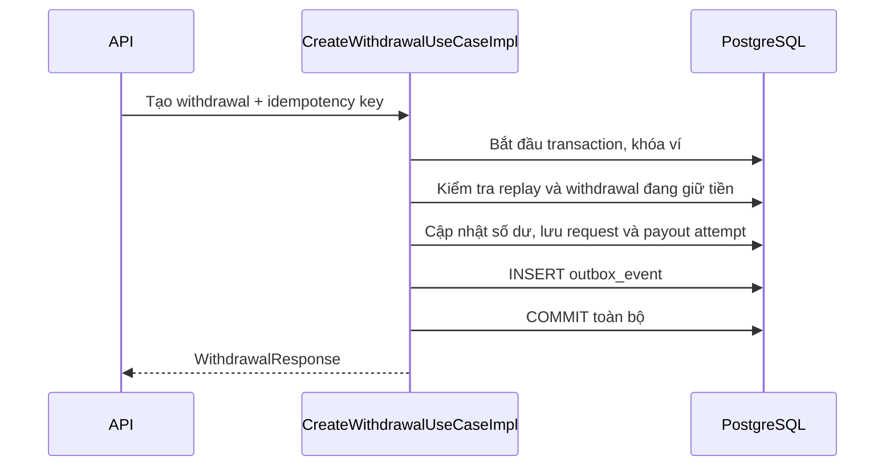
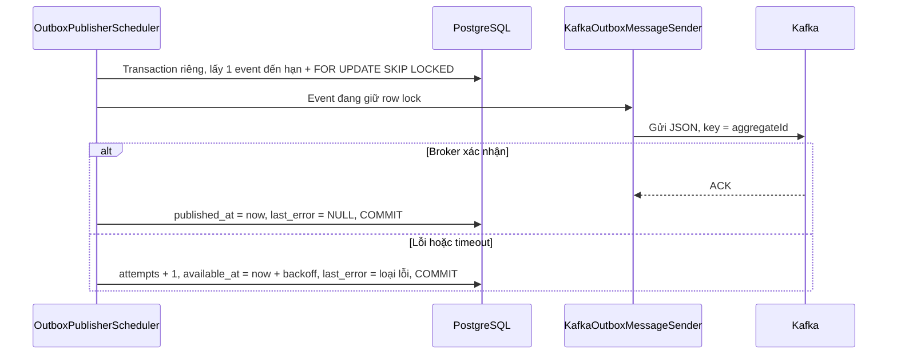

# Transactional outbox dùng chung

Bảng `outbox_event` dùng cho nhiều nghiệp vụ. Withdrawal là nghiệp vụ đầu tiên ghi event. Publisher gửi event lên Kafka; consumer withdrawal đã được nối vào use case. Xem [flow consumer và inbox](withdrawal-kafka.md).

## Luồng tạo withdrawal



Nếu ghi outbox thất bại, transaction rollback cả số dư, withdrawal request và payout attempt. Nếu client gửi lại cùng idempotency key với cùng dữ liệu, use case trả withdrawal cũ và không thêm event. Yêu cầu bị từ chối cũng không thêm event.

## Các file

- `application/port/outbox/OutboxEvent.java`: envelope dùng chung, gồm ID event, aggregate, loại event, phiên bản payload, destination alias, payload và thời điểm tạo.
- `application/port/outbox/OutboxEventWriter.java`: port để application yêu cầu ghi event trong transaction nghiệp vụ đang chạy.
- `infrastructure/persistence/model/entity/OutboxEventEntity.java`: JPA entity ánh xạ đầy đủ các cột, dùng JSONB cho payload. Implement `Persistable` để event mới có UUID sẵn vẫn được INSERT; trùng ID gây lỗi thay vì ghi đè event cũ.
- `infrastructure/persistence/mapper/OutboxEventMapper.java`: chuyển envelope application sang entity và serialize payload thành JSON.
- `infrastructure/persistence/repository/SpringDataOutboxEventRepository.java`: Spring Data JPA repository.
- `infrastructure/persistence/repository/OutboxEventWriterImpl.java`: implement port bằng mapper và repository. `@Transactional(propagation = MANDATORY)` yêu cầu transaction đang có; `saveAndFlush` ghi trong transaction đó và phát hiện lỗi constraint trước khi trả về. Flush chưa phải commit.
- `infrastructure/src/main/resources/db/migration/V17__create_outbox_event.sql`: tạo bảng và index. Không có foreign key riêng tới withdrawal để dùng được cho nhiều nghiệp vụ.
- `CreateWithdrawalUseCaseImpl.java`: thêm event sau khi lưu request và attempt, trước commit. Port `WithdrawalWorkQueue` cũ chưa được dùng đã được bỏ.

Contract outbox giữ ở application vì phục vụ tích hợp, không phải domain entity nghiệp vụ. Persistence dùng cùng mô hình entity → mapper → Spring Data repository như các bảng hiện có; không còn adapter ghi SQL trực tiếp.

Đường dẫn application và infrastructure ở trên tương ứng với package `com.tyson.digitalwallet.ddd` trong các module backend.

## Cột trong bảng

| Cột | Ý nghĩa |
| --- | --- |
| `id` | ID duy nhất của event; consumer sau này dùng để chống xử lý trùng |
| `aggregate_type`, `aggregate_id` | Loại và ID đối tượng nghiệp vụ, ví dụ WITHDRAWAL và withdrawal ID |
| `event_type`, `schema_version` | Loại event và phiên bản contract payload |
| `destination` | Alias logic, ví dụ `withdrawal-process`; publisher bước sau ánh xạ qua `spring.kafka.topics` |
| `payload` | JSONB chứa dữ liệu event |
| `created_at` | Thời điểm tạo event |
| `published_at` | Thời điểm Kafka đã xác nhận và database đã commit kết quả gửi; NULL khi còn chờ gửi |
| `attempts`, `available_at`, `last_error` | Số lần gửi lỗi, lần thử tiếp theo và loại lỗi gần nhất |

Có partial index cho event chưa publish và index tìm theo aggregate. Bảng lưu event tích hợp, không phải thông báo hiển thị cho người dùng và không thay thế bảng notification.

Event hiện tại:

```json
{
  "aggregateType": "WITHDRAWAL",
  "aggregateId": "<withdrawal-id>",
  "eventType": "WITHDRAWAL_PROCESS_REQUESTED",
  "schemaVersion": 1,
  "destination": "withdrawal-process",
  "payload": { "withdrawalId": "<withdrawal-id>" }
}
```

Payload không chứa PIN hoặc thông tin tài khoản nhận tiền. Nghiệp vụ khác có thể dùng cùng writer và bảng với aggregate/event/payload tương ứng, rồi cấu hình destination cần thiết khi triển khai publisher.

## Publisher đã triển khai



Mỗi poll xử lý tối đa `batch-size` event; mỗi event có một transaction `REQUIRES_NEW`. Query qua Spring Data JPA chỉ chọn hàng chưa publish và đến hạn; `FOR UPDATE SKIP LOCKED` cho phép instance khác lấy hàng khác. Chỉ giữ khóa hàng outbox, không giữ khóa ví trong lúc chờ Kafka. Khi worker dừng đột ngột, transaction rollback và database giải phóng khóa để poll sau thử lại; không có lease cần thu hồi.

Cách này giữ connection/transaction database trong lúc chờ Kafka và phù hợp bước triển khai hiện tại. `max.block.ms` giới hạn chờ metadata/buffer trước khi send trả future; `ack-timeout` giới hạn chờ future. Với mặc định, mỗi event có thể chờ khoảng 5s trước future và tối đa 12s cho future. Nếu cần throughput cao hơn có thể chuyển sang claim/lease hoặc CDC sau khi đo tải.

Các file mới trong infrastructure:

- `config/OutboxPublisherProperties.java`: bind và validate phần mở rộng `spring.kafka.outbox`, tính exponential backoff có giới hạn.
- `config/OutboxPublisherConfiguration.java`: đăng ký worker, sender và scheduler khi bật; scheduler outbox tách khỏi `taskScheduler` mặc định cho các job hiện có.
- `messaging/outbox/OutboxMessageSender.java`: giao diện transport nội bộ infrastructure, không đưa Kafka vào domain/application.
- `messaging/outbox/KafkaOutboxMessageSender.java`: ánh xạ destination qua `spring.kafka.topics`, tạo JSON và chờ KafkaTemplate future xác nhận.
- `messaging/outbox/OutboxPublisher.java`: vòng lặp batch, transaction cho từng hàng, cập nhật metadata bằng JPA dirty checking.
- `scheduler/OutboxPublisherScheduler.java`: gọi publisher định kỳ.
- `SpringDataOutboxEventRepository.java`: bổ sung native query khóa hàng PostgreSQL; phần lưu và cập nhật vẫn dùng JPA.

JSON trên Kafka gồm `eventId`, `aggregateType`, `aggregateId`, `eventType`, `schemaVersion`, `createdAt` dạng UTC string và `payload` là JSON object gốc. Message key là `aggregateId`; destination chỉ là alias định tuyến nội bộ. Event ID giữ nguyên khi retry. Không đưa PIN hoặc tài khoản nhận tiền vào message.

Cấu hình trong `application.yaml`:

| Thuộc tính | Mặc định | Ý nghĩa |
| --- | --- | --- |
| `spring.kafka.outbox.enabled` | true | Bật publisher; đổi qua `OUTBOX_PUBLISHER_ENABLED` |
| `spring.kafka.outbox.batch-size` | 20 | Số hàng tối đa mỗi poll |
| `spring.kafka.outbox.poll-interval` | 1s | Delay sau khi batch trước kết thúc |
| `spring.kafka.outbox.initial-delay` | 5s | Chờ trước poll đầu |
| `spring.kafka.outbox.ack-timeout` | 12s | Chờ future Kafka xác nhận |
| `spring.kafka.outbox.initial-backoff` | 1s | Delay sau lần lỗi đầu |
| `spring.kafka.outbox.max-backoff` | 5m | Giới hạn delay; retry tiếp tục, không tự xóa event |
| `spring.kafka.producer.properties[max.block.ms]` | 5000 | Giới hạn chờ metadata/buffer |
| `spring.kafka.producer.properties[request.timeout.ms]` | 5000 | Timeout request producer |
| `spring.kafka.producer.properties[delivery.timeout.ms]` | 10000 | Timeout tổng giao hàng trong producer |

`attempts` đếm lần gửi lỗi. `last_error` chỉ lưu loại exception để tránh ghi dữ liệu nhạy cảm trong message lỗi. Thành công xóa last_error, giữ số lần lỗi để theo dõi. Alias không tồn tại, lỗi JSON, timeout và lỗi broker đều để event retry. Lỗi database khi commit được truyền ra scheduler, hàng vẫn có thể thử lại; không coi lỗi commit là lỗi send thành công.

Đây là at-least-once: Kafka nhận thành công nhưng database chưa commit, hoặc timeout trong khi producer vẫn hoàn tất gửi, đều có thể tạo message trùng. Producer idempotence không loại được mọi lần trùng do retry outbox. Consumer bước sau phải chống xử lý trùng theo eventId và trạng thái nghiệp vụ. Khóa/skip và backoff có thể làm event cùng aggregate được gửi khác thứ tự tạo giữa nhiều worker; key chỉ quyết định partition, chưa bảo đảm thứ tự nghiệp vụ.

## Phạm vi hiện tại và bước tiếp theo

Consumer withdrawal đã được triển khai. Mặc định mode Kafka để khởi phát payout; scheduler chỉ giữ recovery/đối soát, không lấy fresh PENDING. Backlog và chuyển giao được mô tả trong [thiết kế consumer](withdrawal-kafka.md).

Không cần migration mới cho publisher; dùng các cột đã có trong V17. Migration chỉ được chạy trên PostgreSQL kiểm thử riêng trong quá trình này, chưa chạy trên database ứng dụng. Không có thay đổi webhook hay gọi payout provider thật trong các test.

Nguồn đối chiếu: [Spring Kafka - Sending Messages](https://docs.spring.io/spring-kafka/reference/kafka/sending-messages.html), [PostgreSQL - SELECT và SKIP LOCKED](https://www.postgresql.org/docs/current/sql-select.html).

## Kiểm thử

`WithdrawalServiceImplTest` kiểm tra metadata/payload, replay không ghi thêm event, yêu cầu khác bị chặn và lỗi writer được truyền ra ngoài.

`OutboxAtomicityPostgresTest` dùng writer qua Spring transaction proxy và JPA repositories thực trên PostgreSQL trong schema riêng: commit + replay, lỗi insert outbox, rollback từ transaction ngoài, từ chối ghi ngoài transaction, dùng lại cho nghiệp vụ khác và không ghi đè event trùng ID. JDBC chỉ dùng trong fixture để chuẩn bị và kiểm tra database. Không cấu hình `outbox.test.jdbc` thì test này được skip.

Ví dụ chạy với database kiểm thử riêng:

```powershell
mvn -f backend/pom.xml -pl digitalwallet-infrastructure -am '-Dtest=OutboxAtomicityPostgresTest' '-Dsurefire.failIfNoSpecifiedTests=false' '-Doutbox.test.jdbc=jdbc:postgresql://localhost:55439/postgres?user=outbox_test' test
```

Port, database và user trong ví dụ phải được chuẩn bị riêng; không dùng URL database ứng dụng cho kiểm thử này.

`KafkaOutboxMessageSenderTest` kiểm tra JSON envelope, chờ ACK, lỗi, timeout và alias lạ. `OutboxPublisherConfigurationTest` kiểm tra binding, tắt worker, scheduler riêng và backoff. `OutboxPublisherPostgresTest` kiểm tra eligibility/batch, retry qua nhiều worker, hai instance, rollback sau ACK, interruption; khi có cả `outbox.test.jdbc` và `kafka.test.bootstrap-servers` còn kiểm tra PostgreSQL → Kafka và đọc lại JSON bằng consumer kiểm thử. Topic Kafka kiểm thử có tên riêng và được xóa sau test.

```powershell
mvn -f backend/pom.xml -pl digitalwallet-infrastructure -am '-Dtest=OutboxPublisherPostgresTest,KafkaOutboxMessageSenderTest,OutboxPublisherConfigurationTest' '-Dsurefire.failIfNoSpecifiedTests=false' '-Doutbox.test.jdbc=jdbc:postgresql://localhost:55439/postgres?user=outbox_test' '-Dkafka.test.bootstrap-servers=localhost:9092' test
```